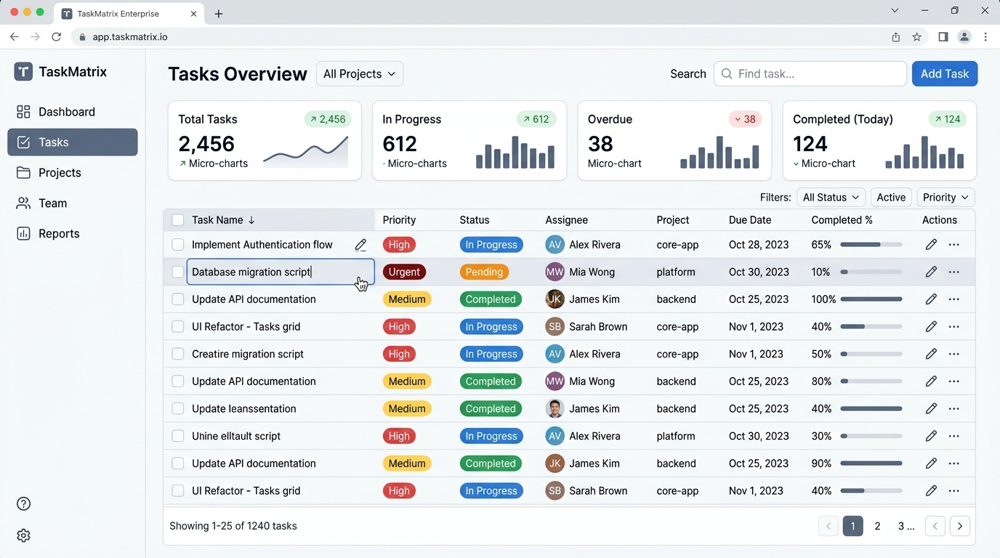
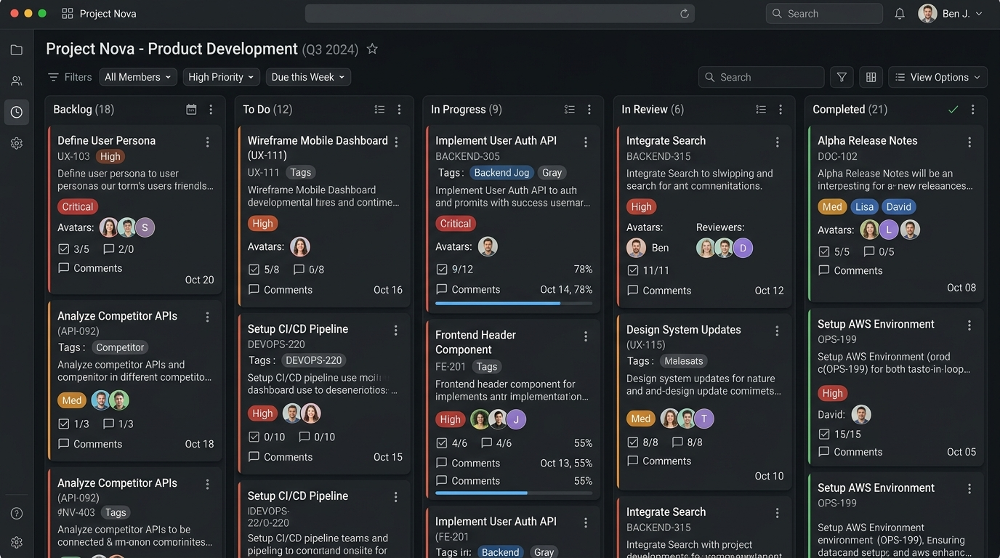
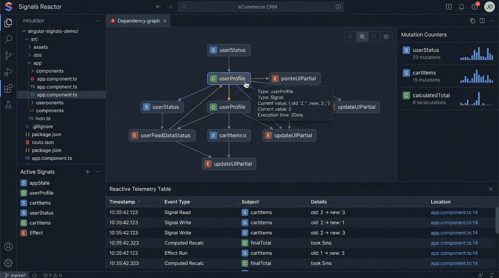

# TaskMatrix Enterprise App

> Responsive enterprise task dashboard engineered with an **Angular-inspired reactive Signals architecture** (`signal`, `computed`, `effect`), **inline double-click editing**, and **local persistent storage**.

---

## 📸 Visual Showcase & Screenshots

### 1. High-Density Enterprise Data Grid & Inline Editing
Real-time task grid with double-click inline cell mutation, column sorting, multi-select batch actions, and high-density KPI telemetry strips.



* **Inline Double-Click Editing**: Double-click any cell (Title, Status, Priority, Assignee, Due Date, Estimated Hours) to immediately activate an in-place editor. Commit with `Enter`, cancel with `Escape`.
* **Multi-Select Batch Execution**: Bulk transition tasks to *Completed* or *In Progress*, or batch delete with safety confirmation.
* **KPI Metrics**: Real-time compute of sprint velocity, hour estimations vs. logged hours, and SLA breach warnings.

---

### 2. Multi-Lane Kanban Board
Five-stage delivery board with agile stage progression, checklist ratios, and inline double-click title editing.



* **Five Standardized Workflow Lanes**: Backlog, To Do, In Progress, In Review, and Completed.
* **Rapid Stage Steppers**: One-click advance (`>`) and regress (`<`) buttons to progress tasks through pipelines.
* **Checklist Progress Bar**: Visual progress fill indicating completed subtasks at a glance.

---

### 3. Angular & JavaScript Signals Architecture Inspector
Live developer telemetry console demonstrating push-pull reactivity, dynamic dependency graphs, and glitch-free memoization.



* **Push-Pull Reactivity**: State updates mark downstream nodes as dirty (`isDirty = true`), while evaluations compute lazily on demand without redundant re-renders.
* **Reactive Telemetry**: Live counter of signal mutations, upstream producer links, and dependent consumers.
* **Atomic Batching**: Groups multi-signal updates into a single execution flush using `batch(() => ...)`.

---

## ⚡ Core Architecture: Angular Signals in Action

The reactive state management implements standard Angular 16+ (`@angular/core`) and TC39 Signals primitives:

```typescript
// 1. Writable Signal (Angular signal() primitive)
export const tasksSignal = signal<Task[]>(loadStoredTasks(), { name: 'tasksSignal' });

// 2. Computed Signal (Memoized & lazily evaluated)
export const filteredTasksSignal = computed(() => {
  const tasks = tasksSignal();
  const search = searchQuerySignal().toLowerCase().trim();
  const status = selectedStatusSignal();
  
  return tasks.filter((t) => (status === 'all' || t.status === status) && t.title.toLowerCase().includes(search));
}, { name: 'filteredTasksSignal' });

// 3. Reactive Effect (Auto-syncs to localStorage)
effect(() => {
  const currentTasks = tasksSignal();
  localStorage.setItem('taskmatrix_enterprise_tasks_v1', JSON.stringify(currentTasks));
}, { name: 'localStoragePersistenceEffect' });
```

---

## 🚀 Key Features

* **Fine-Grained Reactive State**: Zero zone.js or heavy component tree diffing; UI subscribers re-render strictly when their consumed signals mutate.
* **Inline Double-Click Cell Editing**:
  * **Title**: Direct input field with instant commit.
  * **Status**: Semantic dropdown (Backlog, To Do, In Progress, Review, Done).
  * **Priority**: Urgent, High, Medium, Low.
  * **Assignee**: Enterprise team member assignment with role badges.
  * **Due Date**: Date picker with overdue highlighting.
  * **Hours**: Tabular numeric estimation input.
* **Local Persistent Storage**: Automatic continuous state synchronization to `localStorage` with JSON export/import and fallback seeding.
* **Undo / Redo Stack**: State snapshot tracking with `Ctrl+Z` (Undo) and `Ctrl+Y` (Redo) support.
* **Interactive Timeline / Gantt Chart**: Duration spans across calendar weeks with progress bar overlays.
* **Slide-over Task Details Drawer**: Subtask checklist items, task descriptions, and audit history stream.

---

## ⌨️ Keyboard Shortcuts

| Shortcut | Action |
| :--- | :--- |
| `Double Click` on Cell | Activate inline editor for title, status, priority, assignee, date, or hours |
| `Enter` | Commit inline edit |
| `Escape` | Cancel inline edit without changes |
| `Ctrl + Z` / `Cmd + Z` | Undo last modification |
| `Ctrl + Y` / `Cmd + Shift + Z` | Redo previously undone modification |
| `Alt + N` / `Cmd + J` | Open Create Enterprise Task modal |

---

## 🛠️ Getting Started

### Prerequisites
* Node.js $\ge 18$
* npm or pnpm

### Installation & Run

```bash
# Install dependencies
npm install

# Start local development server on port 3000
npm run dev

# Build production bundle
npm run build
```

---

## 📄 License
Apache-2.0
